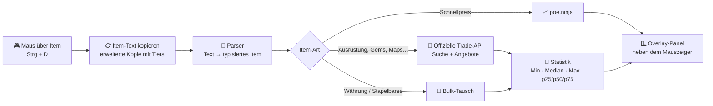
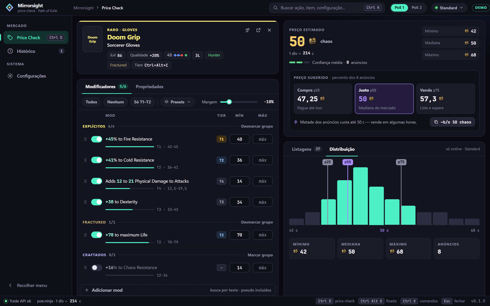
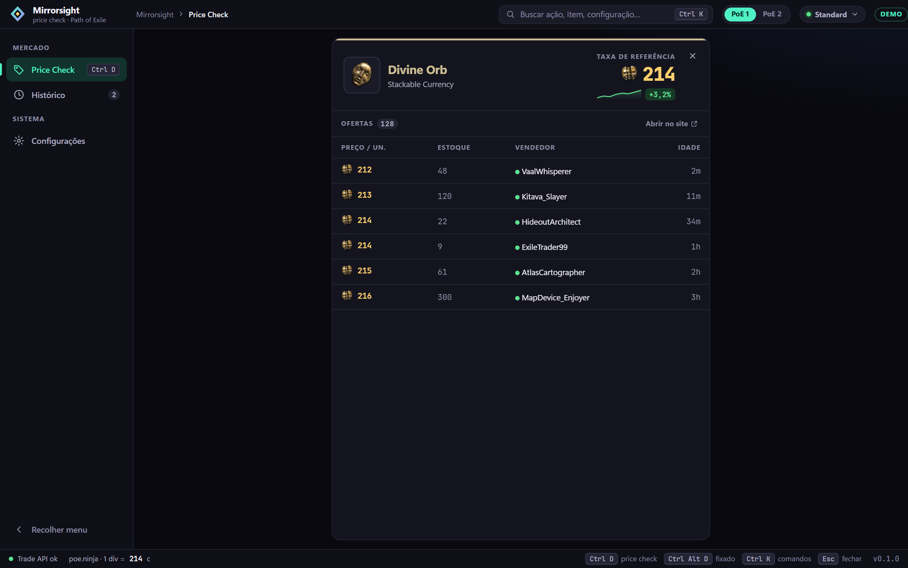

<div align="center">


# Mirrorsight

**Ein schnelles, schönes Preischeck-Overlay für Path of Exile 1 & 2.**
Mit der Maus über einen Gegenstand, <kbd>Strg</kbd> + <kbd>D</kbd> drücken und sofort wissen, was er wert ist — ohne das Spiel zu verlassen.


[](https://github.com/lucas3g/mirrorsight/releases/latest)

[English](README.md) · [Português](README.pt-BR.md) · [中文](README.zh-CN.md) · [日本語](README.ja.md) · [한국어](README.ko.md) · **Deutsch** · [Español](README.es.md)


</div>

---

## ✨ Was ist Mirrorsight?

Mirrorsight ist ein schlankes Desktop-Overlay, das über Path of Exile liegt. Drückst du den Hotkey
über einem Gegenstand, liest es den Gegenstand aus, durchsucht die **offizielle Trade-Seite** mit
sinnvollen Filtern und zeigt dir — direkt neben dem Mauszeiger — einen **geschätzten Preis**, die
**Preisverteilung**, **bearbeitbare Mod-Filter** und die **aktuellen Angebote**. Mit <kbd>Esc</kbd>
schließt du das Panel und der Fokus geht zurück ans Spiel.

Geschrieben in **Rust** (schnell, wenig Speicher, kein Electron) mit einer **Svelte 5**-Oberfläche auf **Tauri 2**.

## 🚀 Funktionen

| | |
|---|---|
| 🎯 **Preischeck per Tastendruck** | <kbd>Strg</kbd>+<kbd>D</kbd> über einem Gegenstand öffnet das Panel neben dem Mauszeiger. |
| 🧮 **Intelligente Schätzung** | Minimum, Median und Maximum plus eine Vertrauensanzeige je nach Anzahl der Angebote. |
| 💡 **Preisvorschlag** | Perzentile *Kaufen* (p25), *Fair* (p50) und *Verkaufen* (p75), inklusive kopierbarer `~b/o`-Notiz. |
| 🎛️ **Bearbeitbare Mod-Filter** | Mods an/aus, Tier (T1…T*n*) und Wertebereich sehen, Min/Max anpassen, Margen-Regler, Mods per Textsuche hinzufügen (inkl. Pseudo-Mods). |
| 💾 **Presets** | Lieblings-Filter pro Spiel speichern und wiederverwenden. |
| 📊 **Verteilungsdiagramm** | Histogramm der Angebotspreise mit p25 / p50 / p75-Markierungen. |
| 💰 **Bulk-Währung** | Währung und stapelbare Items werden über den Bulk-Tausch bewertet (Preis pro Stück, Bestand, Verkäufer). |
| ⚡ **Schnellpreis** | Sofortpreis von **poe.ninja** mit 7-Tage-Trend — ganz ohne Trade-Suche. |
| 🕘 **Verlauf** | Jeder Check wird gespeichert und kann mit denselben Filtern erneut geöffnet werden. |
| ⌨️ **Befehlspalette** | <kbd>Strg</kbd>+<kbd>K</kbd> zum Navigieren, Spiel oder Liga wechseln, Verlauf löschen… |
| 🎮 **PoE 1 & PoE 2** | Spiel und Liga direkt in der Titelleiste wechseln. |
| 🛡️ **Rate-Limit-bewusst** | Beachtet die `X-Rate-Limit-*`-Header der offiziellen API — keine Sperren, kein Spam. |

## 🔍 So funktioniert es



1. **Erfassen** – solange das Spielfenster im Fokus ist, löst der Hotkey den spieleigenen
   „Item kopieren“-Shortcut aus und liest den Text aus der Zwischenablage (der vorherige Inhalt kann
   automatisch wiederhergestellt werden).
2. **Parsen** – der Text wird zu einem typisierten Item: Seltenheit, Basistyp, Itemlevel, Qualität,
   Sockel, Einflüsse und jeder Modifikator, abgeglichen mit der Stat-Liste der Trade-API (mit Tier und Wertebereich).
3. **Suchen** – Mirrorsight baut eine Trade-Anfrage mit den relevanten Mods (vorausgewählt gemäß
   deinen Einstellungen) und hält die API-Limits ein.
4. **Auswerten** – die Angebote werden in eine gemeinsame Währung umgerechnet (Divine-Kurs von poe.ninja)
   und zusammengefasst: Min / Median / Max, Perzentile, Vertrauen.
5. **Anzeigen** – das Overlay öffnet sich neben dem Mauszeiger. Änderst du einen Filter, läuft die Suche
   automatisch neu. <kbd>Esc</kbd> schließt es und gibt den Fokus ans Spiel zurück.

## 📸 Screenshots

<table>
  <tr>
    <td width="50%"><br/><sub><b>Preischeck</b> — Schätzung, Preisvorschlag, Mod-Filter und Angebote</sub></td>
    <td width="50%"><br/><sub><b>Verteilung</b> — Histogramm mit Perzentil-Markierungen</sub></td>
  </tr>
  <tr>
    <td><br/><sub><b>Bulk-Währung</b> — Tauschangebote mit Bestand</sub></td>
    <td><br/><sub><b>Schnellpreis</b> — poe.ninja-Wert und 7-Tage-Trend</sub></td>
  </tr>
  <tr>
    <td><br/><sub><b>Befehlspalette</b> — <kbd>Strg</kbd>+<kbd>K</kbd></sub></td>
    <td><br/><sub><b>Einstellungen</b> — frei belegbare Hotkeys</sub></td>
  </tr>
</table>

> Die Oberfläche ist derzeit auf brasilianischem Portugiesisch. Die Screenshots stammen aus dem integrierten Demo-Modus.

## 📦 Erste Schritte

1. **Installieren** — `Mirrorsight_x.y.z_x64-setup.exe` aus dem [neuesten Release](https://github.com/lucas3g/mirrorsight/releases/latest) herunterladen und ausführen
   (oder selbst bauen, siehe [Entwicklung](#-entwicklung)). Die App läuft im Infobereich.
2. **Einrichten** — unter **Einstellungen → Allgemein** Spiel (PoE 1 / PoE 2) und Liga wählen.
3. **Spielen** — im Spiel mit der Maus über ein Item und <kbd>Strg</kbd>+<kbd>D</kbd> drücken. <kbd>Esc</kbd> schließt.

Kein Spiel zur Hand? Füge den Text eines Items mit <kbd>Strg</kbd>+<kbd>V</kbd> ins Hauptfenster ein
(oder <kbd>Strg</kbd>+<kbd>Umschalt</kbd>+<kbd>V</kbd> für den Schnellpreis).

### ⌨️ Standard-Hotkeys

| Hotkey | Aktion |
|---|---|
| <kbd>Strg</kbd> + <kbd>D</kbd> | Preischeck des Items unter dem Mauszeiger |
| <kbd>Strg</kbd> + <kbd>Alt</kbd> + <kbd>D</kbd> | Preischeck, bereits angeheftet |
| <kbd>Umschalt</kbd> + <kbd>Leertaste</kbd> | Overlay ein-/ausblenden |
| <kbd>Strg</kbd> + <kbd>Umschalt</kbd> + <kbd>O</kbd> | Einstellungen öffnen |
| <kbd>Strg</kbd> + <kbd>K</kbd> | Befehlspalette (innerhalb von Mirrorsight) |
| <kbd>Esc</kbd> | Panel schließen und Fokus ans Spiel zurückgeben |

Alle globalen Hotkeys lassen sich unter **Einstellungen → Hotkeys** neu belegen. Sie sind nur aktiv,
solange das Spielfenster im Fokus ist — anderen Programmen werden also nie Tasten weggenommen.

> **Tipp:** Läuft Path of Exile als Administrator, starte auch Mirrorsight als Administrator — Windows
> blockiert Tastenereignisse von einem normalen an einen erhöhten Prozess.

### ⚙️ Einstellungen

- **Allgemein** — Spiel, Liga, Client-Sprache, Anzeigewährung, Zwischenablage wiederherstellen, mit Windows starten.
- **Preischeck** — Mod-Wertebereich, Offline-Verkäufer anzeigen, standardmäßig aktive Filter, Standard-Itemlevel, Verlauf, Presets.
- **Darstellung** — Skalierung (90–130 %), Dichte, reduzierte Animationen.

## 🛠 Entwicklung

Voraussetzungen: **Rust ≥ 1.80**, **Node ≥ 20**, Windows 10/11 (WebView2).

```sh
cd apps/desktop
npm install
npm run dev          # nur die UI, im Browser, mit Demodaten
npx tauri dev        # die komplette Desktop-App
npx tauri build      # NSIS-Installer in <root>/target/release/bundle/nsis
```

Tests und Lint:

```sh
cargo test --workspace
cargo clippy --workspace --all-targets
cd apps/desktop && npm run check
# gegen die echten APIs (verbraucht Rate-Limit — sparsam verwenden):
cargo test -p mirrorsight-infrastructure --test live -- --ignored --nocapture
```

### 🧱 Architektur (Clean Architecture)

```
crates/domain          Entitäten, reine Regeln und Ports (Traits). Kein I/O.
crates/parser          Ctrl+C / Ctrl+Alt+C-Text → Item (Mods mit Trade-API-Stats abgeglichen)
crates/application     Use Cases (Preischeck, Item aus dem Spiel kopieren, Einstellungen, Ligen)
crates/infrastructure  Adapter: Trade-API + Rate-Limiter, poe.ninja, Win32, Zwischenablage, Einstellungen
apps/desktop/src-tauri Composition Root, Commands, Hotkeys, Overlay, Tray
apps/desktop/src       Svelte-5-UI; spricht nur über den `Backend`-Port mit dem Backend
                       (Adapter: echtes Tauri und eine Browser-Demo)
```

### 🔄 Wartung pro Liga

- **Trade-API-Stats** (der Parser braucht sie, um Mods zu erkennen):
  `node tools/stats/update-stats.mjs` → aktualisiert `crates/parser/data/stats-*.tsv`.
- **Währungs-Icons**: aus der lokalen Spielinstallation nach
  `apps/desktop/public/assets/currency/` extrahiert (PNG + `manifest.json`).

## ⚠️ Hinweis

Mirrorsight ist ein unabhängiges Projekt und **weder mit Grinding Gear Games verbunden noch von ihnen
unterstützt**. Item- und Währungsgrafiken © Grinding Gear Games. Es nutzt die öffentlichen APIs von
pathofexile.com und hält die in den `X-Rate-Limit-*`-Headern angegebenen Limits ein. Es liest keinen
Spielspeicher und automatisiert kein Gameplay — es nutzt nur den spieleigenen Shortcut zum Kopieren von Items.

## 📄 Lizenz

[MIT](LICENSE)
