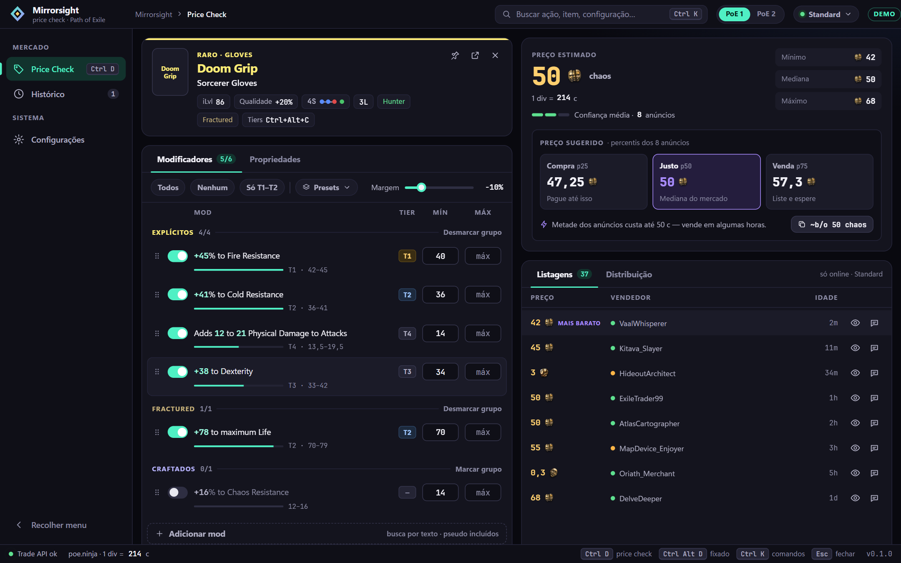
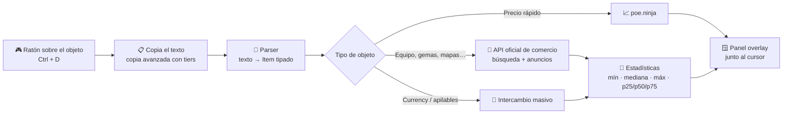
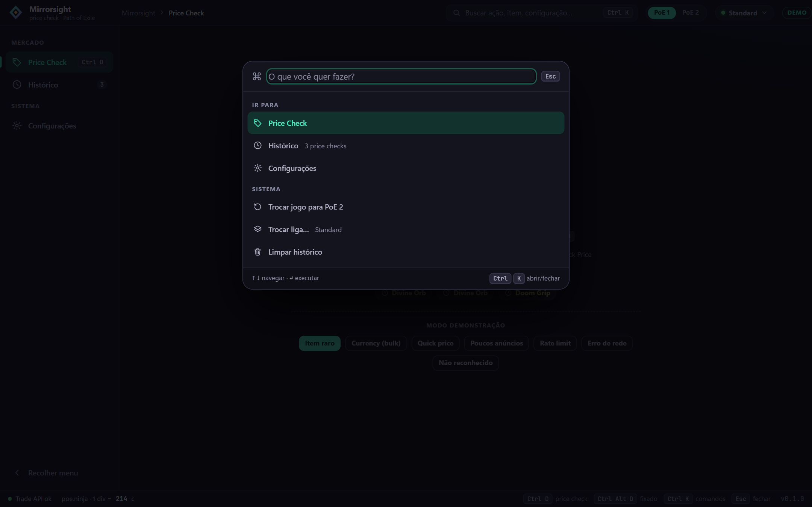

<div align="center">


# Mirrorsight

**Un overlay de consulta de precios rápido y elegante para Path of Exile 1 y 2.**
Pasa el ratón sobre un objeto, pulsa <kbd>Ctrl</kbd> + <kbd>D</kbd> y descubre cuánto vale — sin salir del juego.


[English](README.md) · [Português](README.pt-BR.md) · [中文](README.zh-CN.md) · [日本語](README.ja.md) · [한국어](README.ko.md) · [Deutsch](README.de.md) · **Español**



</div>

---

## ✨ ¿Qué es Mirrorsight?

Mirrorsight es un overlay ligero que se muestra encima de Path of Exile. Al pulsar la tecla rápida
sobre un objeto, lo lee, busca en el **sitio oficial de comercio** con filtros razonables y te muestra
— junto al cursor — el **precio estimado**, la **distribución de precios**, los **filtros de mods
editables** y los **anuncios en vivo**. Al terminar, <kbd>Esc</kbd> cierra el panel y devuelve el
foco al juego.

Está escrito en **Rust** (rápido, poca memoria, sin Electron) con una interfaz en **Svelte 5** sobre **Tauri 2**.

## 🚀 Funcionalidades

| | |
|---|---|
| 🎯 **Consulta con una tecla** | <kbd>Ctrl</kbd>+<kbd>D</kbd> sobre cualquier objeto abre el panel junto al cursor. |
| 🧮 **Estimación inteligente** | Mínimo, mediana y máximo, más un indicador de confianza según la cantidad de anuncios. |
| 💡 **Precio sugerido** | Percentiles *Compra* (p25), *Justo* (p50) y *Venta* (p75), con la nota `~b/o` lista para copiar. |
| 🎛️ **Filtros de mods editables** | Activa/desactiva mods, ve su tier (T1…T*n*) y rango, ajusta mín/máx, usa el control de margen y añade mods por búsqueda de texto (pseudo incluidos). |
| 💾 **Presets** | Guarda tus combinaciones de filtros favoritas por juego y reutilízalas. |
| 📊 **Gráfico de distribución** | Histograma de precios con marcadores p25 / p50 / p75. |
| 💰 **Currency al por mayor** | La currency y los objetos apilables se valoran mediante el intercambio masivo (precio por unidad, stock, vendedor). |
| ⚡ **Precio rápido** | Precio instantáneo de **poe.ninja** con tendencia de 7 días — sin búsqueda en el comercio. |
| 🕘 **Historial** | Cada consulta se guarda y se puede reabrir con los mismos filtros. |
| ⌨️ **Paleta de comandos** | <kbd>Ctrl</kbd>+<kbd>K</kbd> para ir a cualquier sitio, cambiar de juego o liga, borrar el historial… |
| 🎮 **PoE 1 y PoE 2** | Cambia de juego y de liga desde la barra de título. |
| 🛡️ **Respeta el rate limit** | Sigue las cabeceras `X-Rate-Limit-*` de la API oficial — sin baneos, sin spam. |

## 🔍 Cómo funciona



1. **Captura** – con la ventana del juego enfocada, la tecla rápida lanza el atajo de "copiar objeto"
   del propio juego y lee el texto del portapapeles (el contenido anterior puede restaurarse automáticamente).
2. **Análisis** – el texto se convierte en un objeto tipado: rareza, base, nivel de objeto, calidad,
   engarces, influencias y cada modificador emparejado con la lista de stats de la API (con tier y rango).
3. **Búsqueda** – Mirrorsight construye la consulta con los mods relevantes (preseleccionados según tu
   configuración), respetando los límites de la API.
4. **Cálculo** – los anuncios se convierten a una moneda común (con la tasa del divine de poe.ninja)
   y se resumen: mín / mediana / máx, percentiles, confianza.
5. **Resultado** – el overlay se abre junto al cursor. Cambia cualquier filtro y la búsqueda se repite
   sola. <kbd>Esc</kbd> lo cierra y devuelve el foco al juego.

## 📸 Capturas

<table>
  <tr>
    <td width="50%"><br/><sub><b>Consulta de precio</b> — estimación, precio sugerido, filtros y anuncios</sub></td>
    <td width="50%"><br/><sub><b>Distribución</b> — histograma con percentiles</sub></td>
  </tr>
  <tr>
    <td><br/><sub><b>Currency al por mayor</b> — ofertas con stock</sub></td>
    <td><br/><sub><b>Precio rápido</b> — valor de poe.ninja y tendencia de 7 días</sub></td>
  </tr>
  <tr>
    <td><br/><sub><b>Paleta de comandos</b> — <kbd>Ctrl</kbd>+<kbd>K</kbd></sub></td>
    <td><br/><sub><b>Ajustes</b> — teclas rápidas reasignables</sub></td>
  </tr>
</table>

> La interfaz está actualmente en portugués de Brasil. Las capturas se tomaron en el modo demo integrado.

## 📦 Primeros pasos

1. **Instala** — genera el instalador (ver [Desarrollo](#-desarrollo)) y ejecuta
   `target/release/bundle/nsis/Mirrorsight_*_x64-setup.exe`. La app vive en la bandeja del sistema.
2. **Configura** — en **Ajustes → General**, elige el juego (PoE 1 / PoE 2) y la liga.
3. **Juega** — pasa el ratón sobre un objeto y pulsa <kbd>Ctrl</kbd>+<kbd>D</kbd>. <kbd>Esc</kbd> cierra.

¿Sin el juego abierto? Pega el texto de un objeto en la ventana principal con <kbd>Ctrl</kbd>+<kbd>V</kbd>
(o <kbd>Ctrl</kbd>+<kbd>Shift</kbd>+<kbd>V</kbd> para el precio rápido).

### ⌨️ Teclas rápidas por defecto

| Tecla | Acción |
|---|---|
| <kbd>Ctrl</kbd> + <kbd>D</kbd> | Consultar el precio del objeto bajo el cursor |
| <kbd>Ctrl</kbd> + <kbd>Alt</kbd> + <kbd>D</kbd> | Consulta ya fijada en pantalla |
| <kbd>Shift</kbd> + <kbd>Space</kbd> | Mostrar / ocultar el overlay |
| <kbd>Ctrl</kbd> + <kbd>Shift</kbd> + <kbd>O</kbd> | Abrir ajustes |
| <kbd>Ctrl</kbd> + <kbd>K</kbd> | Paleta de comandos (dentro de Mirrorsight) |
| <kbd>Esc</kbd> | Cerrar el panel y devolver el foco al juego |

Todas las teclas globales se pueden reasignar en **Ajustes → Hotkeys**. Solo se registran mientras
la ventana del juego está enfocada, así que nunca roban teclas a otras aplicaciones.

> **Consejo:** si Path of Exile se ejecuta como administrador, ejecuta Mirrorsight también como
> administrador — Windows bloquea el envío de teclas de un proceso normal a uno elevado.

### ⚙️ Ajustes

- **General** — juego, liga, idioma del cliente, moneda de visualización, restaurar portapapeles, iniciar con Windows.
- **Consulta de precio** — rango de mods, mostrar vendedores desconectados, filtros marcados por defecto, nivel por defecto, historial, presets.
- **Apariencia** — escala de la interfaz (90–130 %), densidad, reducir animaciones.

## 🛠 Desarrollo

Requisitos: **Rust ≥ 1.80**, **Node ≥ 20**, Windows 10/11 (WebView2).

```sh
cd apps/desktop
npm install
npm run dev          # solo la UI, en el navegador, con datos de demo
npx tauri dev        # la app de escritorio completa
npx tauri build      # instalador NSIS en <raíz>/target/release/bundle/nsis
```

Tests y lint:

```sh
cargo test --workspace
cargo clippy --workspace --all-targets
cd apps/desktop && npm run check
# contra las APIs reales (consume rate limit — úsalo con moderación):
cargo test -p mirrorsight-infrastructure --test live -- --ignored --nocapture
```

### 🧱 Arquitectura (clean architecture)

```
crates/domain          entidades, reglas puras y ports (traits). Sin I/O.
crates/parser          texto de Ctrl+C / Ctrl+Alt+C → Item (mods emparejados con los stats de la API)
crates/application     casos de uso (consulta de precio, copiar objeto, ajustes, ligas)
crates/infrastructure  adaptadores: API de comercio + rate limiter, poe.ninja, Win32, portapapeles, ajustes
apps/desktop/src-tauri composition root, comandos, teclas rápidas, overlay, bandeja
apps/desktop/src       UI en Svelte 5; habla con el backend solo a través del port `Backend`
                       (adaptadores: Tauri real y demo para el navegador)
```

### 🔄 Mantenimiento en cada liga

- **Stats de la API de comercio** (el parser los necesita para reconocer mods):
  `node tools/stats/update-stats.mjs` → actualiza `crates/parser/data/stats-*.tsv`.
- **Iconos de currency**: extraídos de la instalación local del juego a
  `apps/desktop/public/assets/currency/` (PNG + `manifest.json`).

## ⚠️ Aviso

Mirrorsight es un proyecto independiente y **no está afiliado ni respaldado por Grinding Gear Games**.
Arte de objetos y currency © Grinding Gear Games. Usa las APIs públicas de pathofexile.com y respeta
los límites indicados en las cabeceras `X-Rate-Limit-*`. No lee la memoria del juego ni automatiza el
juego — solo usa el atajo de copiar objeto del propio juego.

## 📄 Licencia

[MIT](LICENSE)
