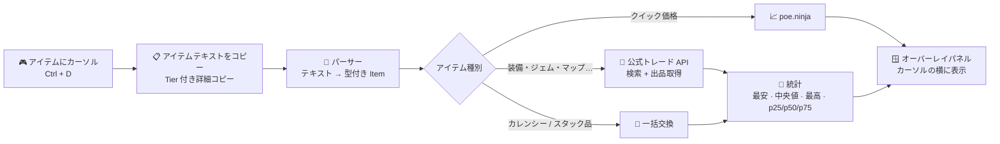

<div align="center">


# Mirrorsight

**Path of Exile 1 & 2 のための、速くて美しい価格チェック・オーバーレイ。**
アイテムにカーソルを合わせて <kbd>Ctrl</kbd> + <kbd>D</kbd> を押すだけ — ゲームを離れずに相場がわかります。


[](https://github.com/lucas3g/mirrorsight/releases/latest)

[English](README.md) · [Português](README.pt-BR.md) · [中文](README.zh-CN.md) · **日本語** · [한국어](README.ko.md) · [Deutsch](README.de.md) · [Español](README.es.md)


</div>

---

## ✨ Mirrorsight とは？

Mirrorsight は Path of Exile の上に重ねて表示する軽量なデスクトップ・オーバーレイです。アイテムの上で
ホットキーを押すと、アイテムを読み取り、適切なフィルターで**公式トレードサイト**を検索し、カーソルの
すぐ横に**推定価格**・**価格分布**・**編集可能な Mod フィルター**・**最新の出品一覧**を表示します。
確認が終わったら <kbd>Esc</kbd> でパネルを閉じ、フォーカスがゲームに戻ります。

**Rust** で書かれており（高速・省メモリ・Electron 不使用）、UI は **Tauri 2** 上の **Svelte 5** です。

## 🚀 機能

| | |
|---|---|
| 🎯 **ワンキー価格チェック** | アイテム上で <kbd>Ctrl</kbd>+<kbd>D</kbd> を押すと、カーソルの横にパネルが開きます。 |
| 🧮 **賢い価格推定** | 最安値・中央値・最高値に加え、出品数に基づく信頼度インジケーター。 |
| 💡 **推奨価格** | *買い* (p25)・*適正* (p50)・*売り* (p75) のパーセンタイルと、ワンクリックでコピーできる `~b/o` ノート。 |
| 🎛️ **編集可能な Mod フィルター** | Mod のオン/オフ、Tier (T1…T*n*) とロール範囲の表示、最小/最大値の調整、マージンスライダー、テキスト検索による Mod 追加（擬似 Mod 含む）。 |
| 💾 **プリセット** | よく使うフィルター構成をゲームごとに保存して再利用。 |
| 📊 **分布チャート** | 出品価格のヒストグラムに p25 / p50 / p75 マーカーを表示。 |
| 💰 **カレンシー一括取引** | カレンシーやスタック可能なアイテムは一括交換で価格を表示（単価・在庫・出品者）。 |
| ⚡ **クイック価格** | **poe.ninja** の価格と 7 日間のトレンドを即表示 — トレード検索不要。 |
| 🕘 **履歴** | すべてのチェックを保存し、同じフィルターで再表示できます。 |
| ⌨️ **コマンドパレット** | <kbd>Ctrl</kbd>+<kbd>K</kbd> で画面移動、ゲームやリーグの切り替え、履歴の消去など。 |
| 🎮 **PoE 1 & PoE 2 対応** | タイトルバーからゲームとリーグを切り替え。 |
| 🛡️ **レート制限を順守** | 公式 API の `X-Rate-Limit-*` ヘッダーに従います — BAN もスパムもなし。 |

## 🔍 仕組み



1. **取得** – ゲームウィンドウがフォーカスされている間、ホットキーがゲーム自身の「アイテムをコピー」
   ショートカットを送り、クリップボードからテキストを読み取ります（元のクリップボード内容は自動で復元可能）。
2. **解析** – テキストを型付きアイテムに変換します：レアリティ、ベースタイプ、アイテムレベル、品質、
   ソケット、インフルエンス、そしてトレード API のステータス一覧と照合した各 Mod（Tier とロール範囲付き）。
3. **検索** – 設定に応じて事前選択された Mod でトレード検索クエリを組み立て、API のレート制限を守って実行します。
4. **分析** – 出品価格を共通の通貨に換算し（poe.ninja のディヴァインレートを使用）、
   最安 / 中央値 / 最高、パーセンタイル、信頼度にまとめます。
5. **表示** – カーソルの横にオーバーレイが開きます。フィルターを変更すると自動で再検索。
   <kbd>Esc</kbd> で閉じてゲームにフォーカスを戻します。

## 📸 スクリーンショット

<table>
  <tr>
    <td width="50%"><br/><sub><b>価格チェック</b> — 推定価格・推奨価格・Mod フィルター・出品一覧</sub></td>
    <td width="50%"><br/><sub><b>分布</b> — パーセンタイル付きヒストグラム</sub></td>
  </tr>
  <tr>
    <td><br/><sub><b>カレンシー一括取引</b> — 在庫付きの交換オファー</sub></td>
    <td><br/><sub><b>クイック価格</b> — poe.ninja の価格と 7 日間トレンド</sub></td>
  </tr>
  <tr>
    <td><br/><sub><b>コマンドパレット</b> — <kbd>Ctrl</kbd>+<kbd>K</kbd></sub></td>
    <td><br/><sub><b>設定</b> — 変更可能なホットキー</sub></td>
  </tr>
</table>

> 現在 UI はブラジルポルトガル語です。スクリーンショットは内蔵のデモモードで撮影しています。

## 📦 はじめかた

1. **インストール** — [最新リリース](https://github.com/lucas3g/mirrorsight/releases/latest) から `Mirrorsight_x.y.z_x64-setup.exe` をダウンロードして実行します
   （自分でビルドする場合は [開発](#-開発) を参照）。アプリはシステムトレイに常駐します。
2. **設定** — **設定 → 一般** でゲーム (PoE 1 / PoE 2) とリーグを選択します。
3. **プレイ** — ゲーム内でアイテムにカーソルを合わせ、<kbd>Ctrl</kbd>+<kbd>D</kbd>。<kbd>Esc</kbd> で閉じます。

ゲームを起動していない場合は、アイテムのテキストをメインウィンドウに <kbd>Ctrl</kbd>+<kbd>V</kbd> で貼り付けてください
（<kbd>Ctrl</kbd>+<kbd>Shift</kbd>+<kbd>V</kbd> でクイック価格）。

### ⌨️ デフォルトのホットキー

| ホットキー | 動作 |
|---|---|
| <kbd>Ctrl</kbd> + <kbd>D</kbd> | カーソル下のアイテムを価格チェック |
| <kbd>Ctrl</kbd> + <kbd>Alt</kbd> + <kbd>D</kbd> | 画面に固定した状態で価格チェック |
| <kbd>Shift</kbd> + <kbd>Space</kbd> | オーバーレイの表示 / 非表示 |
| <kbd>Ctrl</kbd> + <kbd>Shift</kbd> + <kbd>O</kbd> | 設定を開く |
| <kbd>Ctrl</kbd> + <kbd>K</kbd> | コマンドパレット（Mirrorsight 内） |
| <kbd>Esc</kbd> | パネルを閉じてゲームにフォーカスを戻す |

グローバルホットキーはすべて **設定 → ホットキー** で変更できます。ゲームウィンドウがフォーカスされている
間だけ登録されるため、他のアプリのキー操作を奪うことはありません。

> **ヒント：** Path of Exile を管理者として実行している場合は、Mirrorsight も管理者として実行してください。
> Windows は通常権限のプロセスから昇格したプロセスへのキー送信をブロックします。

### ⚙️ 設定項目

- **一般** — ゲーム、リーグ、クライアント言語、表示通貨、クリップボードの復元、Windows 起動時に開始。
- **価格チェック** — Mod の範囲、オフライン出品者の表示、デフォルトで有効なフィルター、デフォルトのレベル、履歴、プリセット。
- **外観** — UI スケール (90–130 %)、表示密度、アニメーションを減らす。

### 🔁 自動アップデート

v0.4.0 以降、Mirrorsight は GitHub Releases から自動でアップデートされます。アプリを開いたときに新しいバージョンがあれば、その場でインストールされます（小さな進捗バーのあと再起動）。プレイ中に新バージョンが出た場合はバックグラウンドでダウンロードされ、ステータスバーとトレイメニューに **再起動して更新** が表示されます。クリックしない限り何も閉じません。**設定 → 一般** でオフにできます。0.3.0 以前は一度だけ手動インストールが必要です。

## 🛠 開発

必要環境：**Rust ≥ 1.80**、**Node ≥ 20**、Windows 10/11 (WebView2)。

```sh
cd apps/desktop
npm install
npm run dev          # UI のみ、ブラウザでデモデータを使用
npx tauri dev        # デスクトップアプリ全体
npx tauri build      # NSIS インストーラーを <ルート>/target/release/bundle/nsis に出力
```

テストと Lint：

```sh
cargo test --workspace
cargo clippy --workspace --all-targets
cd apps/desktop && npm run check
# 実際の API に対して実行（レート制限を消費するので控えめに）：
cargo test -p mirrorsight-infrastructure --test live -- --ignored --nocapture
```

### 🧱 アーキテクチャ（クリーンアーキテクチャ）

```
crates/domain          エンティティ、純粋なルール、ポート (trait)。I/O なし。
crates/parser          Ctrl+C / Ctrl+Alt+C のテキスト → Item（Mod をトレード API のステータスと照合）
crates/application     ユースケース（価格チェック、ゲームからのアイテムコピー、設定、リーグ）
crates/infrastructure  アダプター：トレード API + レートリミッター、poe.ninja、Win32、クリップボード、設定
apps/desktop/src-tauri コンポジションルート、コマンド、ホットキー、オーバーレイ、トレイ
apps/desktop/src       Svelte 5 UI。`Backend` ポート経由でのみバックエンドと通信
                       （アダプター：実際の Tauri とブラウザ用デモ）
```

### 🔄 リーグごとのメンテナンス

- **トレード API のステータス**（パーサーが Mod を認識するために必要）：
  `node tools/stats/update-stats.mjs` → `crates/parser/data/stats-*.tsv` を更新。
- **カレンシーアイコン**：ローカルのゲームインストールから
  `apps/desktop/public/assets/currency/` に抽出（PNG + `manifest.json`）。

## ⚠️ 免責事項

Mirrorsight は独立したプロジェクトであり、**Grinding Gear Games とは提携しておらず、承認も受けていません**。
アイテムおよびカレンシーのアート © Grinding Gear Games。pathofexile.com の公開 API を使用し、
`X-Rate-Limit-*` ヘッダーで通知される制限を守ります。ゲームのメモリを読み取ったり、ゲームプレイを
自動化したりすることはありません — ゲーム自身のアイテムコピー用ショートカットを使うだけです。

## 📄 ライセンス

[MIT](LICENSE)
