<div align="center">


# Mirrorsight

**패스 오브 엑자일 1 & 2를 위한 빠르고 아름다운 시세 확인 오버레이.**
아이템에 마우스를 올리고 <kbd>Ctrl</kbd> + <kbd>D</kbd>를 누르세요 — 게임을 떠나지 않고 가격을 알 수 있습니다.


[](https://github.com/lucas3g/mirrorsight/releases/latest)

[English](README.md) · [Português](README.pt-BR.md) · [中文](README.zh-CN.md) · [日本語](README.ja.md) · **한국어** · [Deutsch](README.de.md) · [Español](README.es.md)

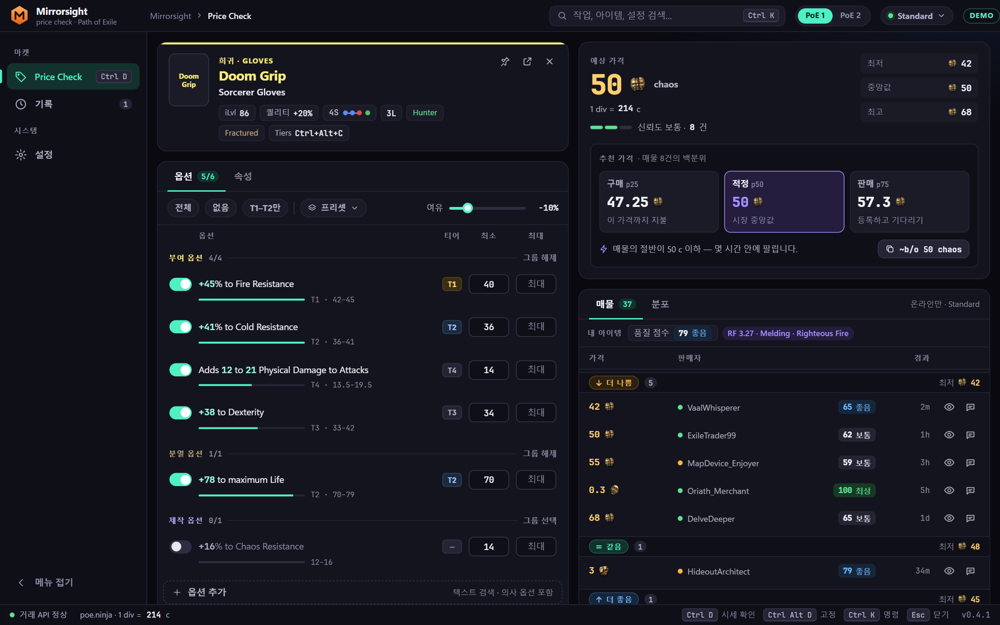

</div>

---

## ✨ Mirrorsight란?

Mirrorsight는 패스 오브 엑자일(Path of Exile) 위에 표시되는 가벼운 데스크톱 오버레이입니다. 아이템 위에서
단축키를 누르면 아이템을 읽고, 적절한 필터로 **공식 거래 사이트**를 검색한 뒤, 마우스 커서 바로 옆에
**예상 가격**, **가격 분포**, **편집 가능한 옵션(Mod) 필터**, **실시간 매물 목록**을 보여 줍니다.
확인이 끝나면 <kbd>Esc</kbd>로 패널을 닫고 포커스가 게임으로 돌아갑니다.

**Rust**로 작성되었으며(빠르고, 메모리를 적게 쓰고, Electron을 사용하지 않음) UI는 **Tauri 2** 위의 **Svelte 5**입니다.

## 🚀 기능

| | |
|---|---|
| 🎯 **원키 시세 확인** | 아이템 위에서 <kbd>Ctrl</kbd>+<kbd>D</kbd>를 누르면 커서 옆에 패널이 열립니다. |
| 📋 **Ctrl+C로도 가능** | *Ctrl+C로 시세 확인*(기본값 켜짐)을 켜 두면 게임 자체의 복사 단축키가 티어와 함께 아이템을 읽고 오버레이를 엽니다 — 텍스트는 그대로 복사됩니다. |
| 🧮 **스마트 가격 추정** | 최저가, 중앙값, 최고가와 함께 매물 수에 따른 신뢰도 표시. |
| 💡 **추천 가격** | *구매* (p25), *적정* (p50), *판매* (p75) 백분위와 클릭 한 번으로 복사하는 `~b/o` 메모. |
| 🎛️ **편집 가능한 옵션 필터** | 옵션 켜기/끄기, 티어(T1…T*n*)와 수치 범위 확인, 최소/최대값 조정, 마진 슬라이더, 텍스트 검색으로 옵션 추가(의사 옵션 포함). |
| 🧠 **아이템 평가 (PoE 1)** | 각 매물에 두 가지 독립적인 평가가 붙습니다: 내 빌드 기준 **업그레이드**(더 좋음 / 더 나쁨 / 동등 — 스탯 전체 조합, 저항 상한, Path of Building 빌드의 능력치 요구치를 비교)와 **아이템 품질**(티어, 수치, 제작 여지로 0–100; 고유 아이템은 실제 수치 범위 기준). 데이터가 부족한 옵션은 *판단 불가*로 표시하며 최대 수치로 가정하지 않습니다. 매물은 더 좋음 / 동등 / 더 나쁨으로 묶이고, 눈 아이콘으로 어떤 스탯이 바뀌는지 정확히 볼 수 있습니다. |
| 💾 **프리셋** | 자주 쓰는 필터 구성을 게임별로 저장하고 재사용. |
| 📊 **분포 차트** | 매물 가격 히스토그램과 p25 / p50 / p75 표시. |
| 💰 **화폐 대량 거래** | 화폐와 중첩 가능한 아이템은 대량 교환으로 시세 확인(개당 가격, 재고, 판매자). |
| ⚡ **빠른 시세** | **poe.ninja**의 즉시 가격과 7일 추세 — 거래 검색 불필요. |
| 🕘 **기록** | 모든 시세 확인이 저장되며 같은 필터로 다시 열 수 있습니다. |
| ⌨️ **명령 팔레트** | <kbd>Ctrl</kbd>+<kbd>K</kbd>로 어디든 이동, 게임·리그 전환, 기록 삭제 등. |
| 🎮 **PoE 1 & PoE 2 지원** | 제목 표시줄에서 게임과 리그를 전환. |
| 🌐 **7개 언어** | English, Português, Español, Deutsch, 简体中文, 日本語, 한국어 — 기본적으로 시스템 언어를 따릅니다. |
| 🛡️ **요청 제한 준수** | 공식 API의 `X-Rate-Limit-*` 헤더를 따릅니다 — 차단도, 스팸도 없습니다. |

## 🔍 작동 방식

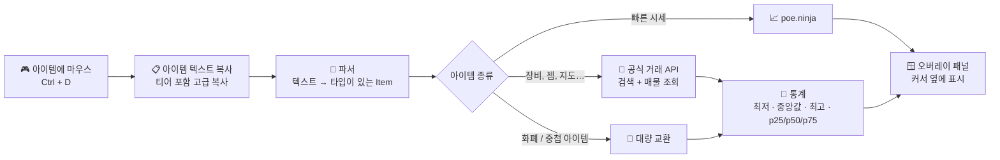

1. **캡처** – 게임 창에 포커스가 있을 때 단축키가 게임 자체의 "아이템 복사" 단축키를 보내고 클립보드에서
   텍스트를 읽습니다(이전 클립보드 내용은 자동으로 복원할 수 있습니다).
2. **파싱** – 텍스트를 타입이 있는 아이템으로 변환합니다: 희귀도, 기본 유형, 아이템 레벨, 퀄리티, 홈,
   영향력, 그리고 거래 API 스탯 목록과 매칭된 각 옵션(티어와 수치 범위 포함).
3. **검색** – 설정에 따라 미리 선택된 옵션으로 거래 쿼리를 만들고, API 요청 제한을 지키며 실행합니다.
4. **분석** – 매물 가격을 공통 화폐로 환산하고(poe.ninja의 디바인 시세 사용)
   최저 / 중앙값 / 최고, 백분위, 신뢰도로 요약합니다.
5. **표시** – 커서 옆에 오버레이가 열립니다. 필터를 바꾸면 자동으로 다시 검색합니다.
   <kbd>Esc</kbd>로 닫으면 게임으로 포커스가 돌아갑니다.

## 📸 스크린샷

<table>
  <tr>
    <td width="50%"><br/><sub><b>시세 확인</b> — 예상 가격, 추천 가격, 옵션 필터, 업그레이드 판정별로 묶인 매물</sub></td>
    <td width="50%">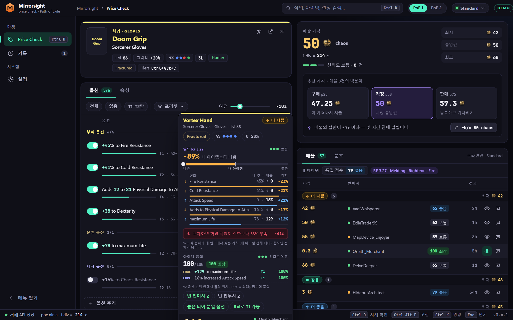<br/><sub><b>아이템 평가</b> — 내 빌드에서 무엇이 바뀌는지와 아이템 품질(눈 아이콘)</sub></td>
  </tr>
  <tr>
    <td>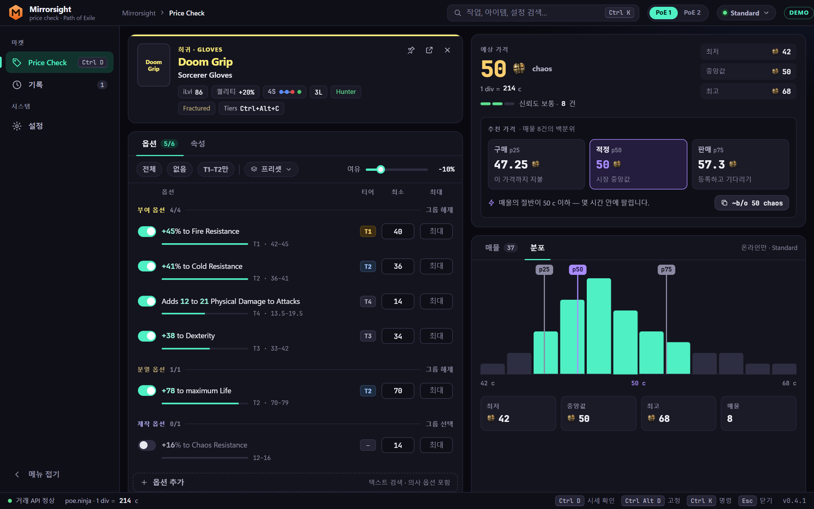<br/><sub><b>분포</b> — 백분위 표시가 있는 히스토그램</sub></td>
    <td>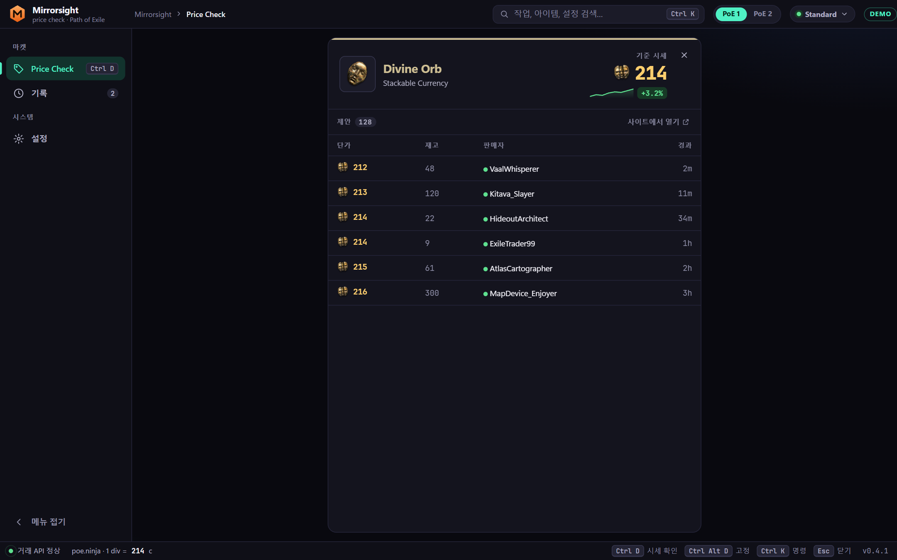<br/><sub><b>화폐 대량 거래</b> — 재고가 포함된 교환 제안</sub></td>
  </tr>
  <tr>
    <td>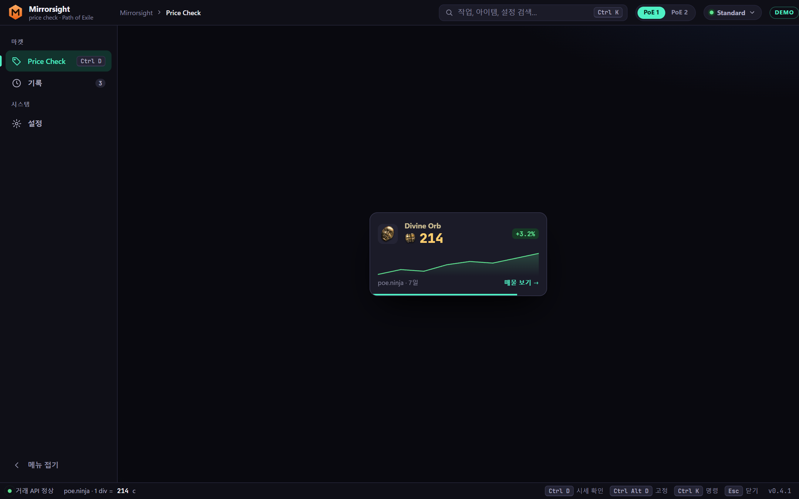<br/><sub><b>빠른 시세</b> — poe.ninja 가격과 7일 추세</sub></td>
    <td>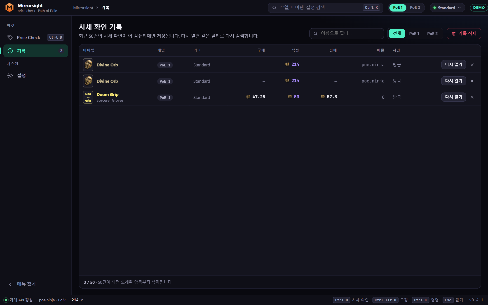<br/><sub><b>기록</b> — 최근 50건, 같은 필터로 다시 열기</sub></td>
  </tr>
  <tr>
    <td>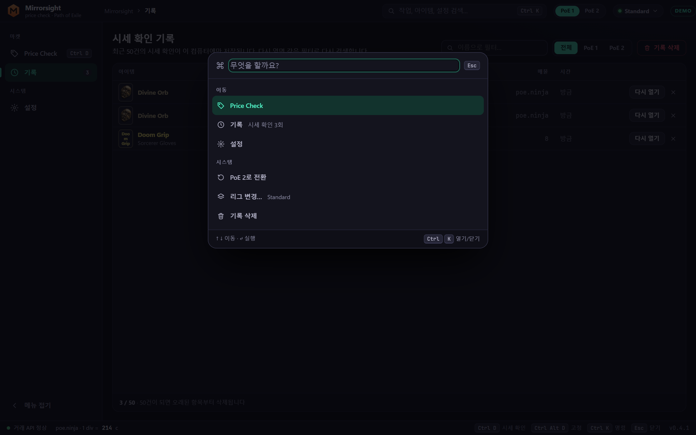<br/><sub><b>명령 팔레트</b> — <kbd>Ctrl</kbd>+<kbd>K</kbd></sub></td>
    <td>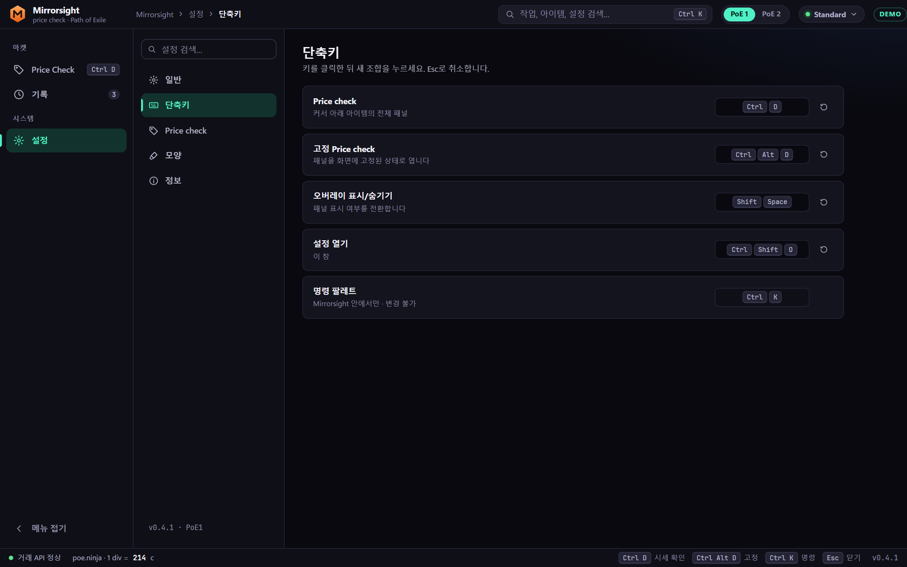<br/><sub><b>단축키</b> — 변경 가능한 단축키</sub></td>
  </tr>
  <tr>
    <td>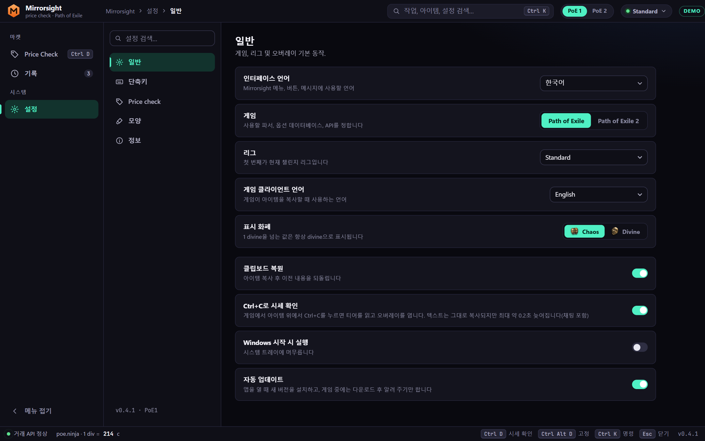<br/><sub><b>설정</b> — 인터페이스 언어, 게임, 리그, 자동 업데이트</sub></td>
    <td>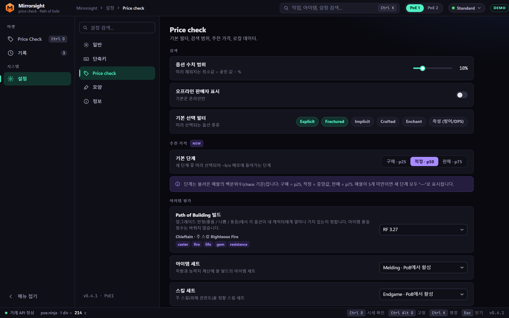<br/><sub><b>Path of Building 빌드</b> — 업그레이드 판정에 쓰는 아이템 세트와 스킬 세트</sub></td>
  </tr>
</table>

> 인터페이스는 English, Português, Español, Deutsch, 简体中文, 日本語, 한국어를 지원합니다(**설정 → 일반 → 인터페이스 언어**, 기본값은 시스템 언어). 스크린샷은 내장 데모 모드에서 촬영했습니다.

## 📦 시작하기

1. **설치** — [최신 릴리스](https://github.com/lucas3g/mirrorsight/releases/latest)에서 `Mirrorsight_x.y.z_x64-setup.exe`를 내려받아 실행합니다
   (직접 빌드하려면 [개발](#-개발) 참고). 앱은 시스템 트레이에 상주합니다.
2. **설정** — **설정 → 일반**에서 게임(PoE 1 / PoE 2)과 리그를 선택합니다.
3. **플레이** — 게임에서 아이템에 마우스를 올리고 <kbd>Ctrl</kbd>+<kbd>D</kbd>. <kbd>Esc</kbd>로 닫습니다.

게임이 실행 중이 아니라면? 아이템 텍스트를 메인 창에 <kbd>Ctrl</kbd>+<kbd>V</kbd>로 붙여 넣으세요
(<kbd>Ctrl</kbd>+<kbd>Shift</kbd>+<kbd>V</kbd>는 빠른 시세).

### ⌨️ 기본 단축키

| 단축키 | 동작 |
|---|---|
| <kbd>Ctrl</kbd> + <kbd>D</kbd> | 커서 아래 아이템 시세 확인 |
| <kbd>Ctrl</kbd> + <kbd>Alt</kbd> + <kbd>D</kbd> | 화면에 고정된 상태로 시세 확인 |
| <kbd>Ctrl</kbd> + <kbd>C</kbd> | 티어 포함 시세 확인, 텍스트는 그대로 복사됨(**설정 → 일반**에서 끌 수 있음) |
| <kbd>Shift</kbd> + <kbd>Space</kbd> | 오버레이 표시 / 숨기기 |
| <kbd>Ctrl</kbd> + <kbd>Shift</kbd> + <kbd>O</kbd> | 설정 열기 |
| <kbd>Ctrl</kbd> + <kbd>K</kbd> | 명령 팔레트(Mirrorsight 내부) |
| <kbd>Esc</kbd> | 패널을 닫고 게임으로 포커스 복귀 |

모든 전역 단축키는 **설정 → 단축키**에서 바꿀 수 있습니다. 게임 창에 포커스가 있을 때만 등록되므로
다른 앱의 키 입력을 가로채지 않습니다.

> **팁:** 패스 오브 엑자일을 관리자 권한으로 실행한다면 Mirrorsight도 관리자 권한으로 실행하세요 —
> Windows는 일반 프로세스가 권한 상승된 프로세스로 키를 보내는 것을 차단합니다.

### ⚙️ 설정 항목

- **일반** — 인터페이스 언어, 게임, 리그, 클라이언트 언어, 표시 화폐, 클립보드 복원, Ctrl+C로 시세 확인, Windows 시작 시 실행, 자동 업데이트.
- **시세 확인** — 옵션 수치 범위, 오프라인 판매자 표시, 기본 선택 필터, 추천 가격 기본 단계, 업그레이드 판정용 Path of Building 빌드(아이템 세트·스킬 세트 포함), 기록, 프리셋.
- **모양** — UI 배율(90–130 %), 밀도, 애니메이션 줄이기.

### 🔁 자동 업데이트

v0.4.0부터 Mirrorsight는 GitHub Releases를 통해 스스로 업데이트됩니다. 앱을 열 때 새 버전이 있으면 바로 설치됩니다(작은 진행 표시줄 후 다시 열림). 게임 중에 새 버전이 나오면 백그라운드에서 다운로드되고 상태 표시줄과 트레이 메뉴에 **재시작하여 업데이트** 버튼이 나타납니다. 클릭하기 전에는 아무것도 닫히지 않습니다. **설정 → 일반**에서 끌 수 있습니다. 0.3.0 이하 버전은 한 번 수동으로 설치해야 합니다.

## 🛠 개발

요구 사항: **Rust ≥ 1.80**, **Node ≥ 20**, Windows 10/11 (WebView2).

```sh
cd apps/desktop
npm install
npm run dev          # UI만, 브라우저에서 데모 데이터로 실행
npx tauri dev        # 전체 데스크톱 앱
npx tauri build      # NSIS 설치 프로그램: <루트>/target/release/bundle/nsis
```

테스트와 린트:

```sh
cargo test --workspace
cargo clippy --workspace --all-targets
cd apps/desktop && npm run check
# 실제 API 대상(요청 제한을 소모하니 적당히 실행):
cargo test -p mirrorsight-infrastructure --test live -- --ignored --nocapture
```

README 스크린샷: `node tools/screenshots/capture.mjs`가 데모를 빌드하고 모든 언어를 `docs/screenshots/<언어>/`에 촬영합니다(Node ≥ 22와 Edge 또는 Chrome 필요, `--locales en,ko`로 언어 제한).

### 🧱 아키텍처(클린 아키텍처)

```
crates/domain          엔티티, 순수 규칙, 포트(trait). I/O 없음.
crates/parser          Ctrl+C / Ctrl+Alt+C 텍스트 → Item (옵션을 거래 API 스탯과 매칭)
crates/application     유스케이스(시세 확인, 게임에서 아이템 복사, 설정, 리그)
crates/infrastructure  어댑터: 거래 API + 요청 제한기, poe.ninja, Win32, 클립보드, 설정, PoB 빌드
crates/gamedata        내장 PoE 1 지식 베이스(고유 아이템, 티어, 베이스, 젬) + 평가 규칙
apps/desktop/src-tauri 컴포지션 루트, 커맨드, 단축키, 오버레이, 트레이
apps/desktop/src       Svelte 5 UI; `Backend` 포트를 통해서만 백엔드와 통신
                       (어댑터: 실제 Tauri와 브라우저용 데모)
```

### 🔄 리그마다 하는 유지 보수

- **거래 API 스탯**(파서가 옵션을 인식하는 데 필요):
  `node tools/stats/update-stats.mjs` → `crates/parser/data/stats-*.tsv` 갱신.
- **아이템 지식 베이스**(고유 아이템 수치 범위, 변형, 옵션 티어, 베이스, 젬 태그)는 최신 Path of Building 릴리스에서:
  `node tools/gamedata/update-gamedata.mjs` → `crates/gamedata/data/*.json` 갱신
  (`--local "<PoB 설치 폴더>"`는 로컬 설치를 읽음). 가중치, 시너지, 임계값은 `crates/gamedata/data/rules-poe1.json`에
  있으며 직접 편집합니다. 이후 `cargo test`를 실행하세요.
- **화폐 아이콘**: 로컬 게임 설치 폴더에서
  `apps/desktop/public/assets/currency/`로 추출(PNG + `manifest.json`).

## ⚠️ 고지 사항

Mirrorsight는 독립 프로젝트이며 **Grinding Gear Games와 제휴하거나 승인을 받지 않았습니다**.
아이템 및 화폐 아트 © Grinding Gear Games. pathofexile.com의 공개 API를 사용하며 `X-Rate-Limit-*`
헤더에 안내된 제한을 지킵니다. 게임 메모리를 읽거나 게임 플레이를 자동화하지 않으며,
게임 자체의 아이템 복사 단축키만 사용합니다.

## 📄 라이선스

[MIT](LICENSE)
