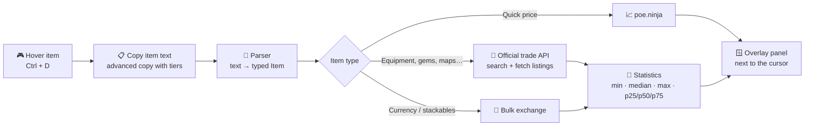

<div align="center">


# Mirrorsight

**A fast, beautiful price-check overlay for Path of Exile 1 & 2.**
Hover an item, press <kbd>Ctrl</kbd> + <kbd>D</kbd>, and know what it's worth — without leaving the game.


[](https://github.com/lucas3g/mirrorsight/releases/latest)

**English** · [Português](README.pt-BR.md) · [中文](README.zh-CN.md) · [日本語](README.ja.md) · [한국어](README.ko.md) · [Deutsch](README.de.md) · [Español](README.es.md)


</div>

---

## ✨ What is Mirrorsight?

Mirrorsight is a lightweight desktop overlay that sits on top of Path of Exile. When you press the
hotkey over an item, it reads the item, searches the **official trade site** with sensible filters,
and shows you — right next to your cursor — an **estimated price**, the **price distribution**,
**editable mod filters** and the **live listings**. When you are done, <kbd>Esc</kbd> closes the panel
and gives focus back to the game.

It is written in **Rust** (fast, low memory, no Electron) with a **Svelte 5** interface on top of **Tauri 2**.

## 🚀 Features

| | |
|---|---|
| 🎯 **One-key price check** | <kbd>Ctrl</kbd>+<kbd>D</kbd> over any item opens the panel next to the cursor. |
| 🧮 **Smart price estimate** | Minimum, median and maximum, plus a confidence indicator based on how many listings were found. |
| 💡 **Suggested price** | *Buy* (p25), *Fair* (p50) and *Sell* (p75) percentiles, with a one-click `~b/o` note to copy. |
| 🎛️ **Editable mod filters** | Toggle mods on/off, see their tier (T1…T*n*) and roll range, adjust min/max, use a margin slider, add mods by text search (pseudo mods included). |
| 🧠 **Item evaluation (PoE 1)** | Each listing gets two independent reads: **upgrade** for your build (Better / Worse / Equivalent, comparing the whole set of stats, resistance caps and attribute requirements from your Path of Building build) and **item quality** (0–100 from tiers, rolls, crafting potential; uniques by their real roll ranges). Mods without enough data are marked *inconclusive*, never assumed perfect. |
| 💾 **Presets** | Save your favourite filter setups per game and reuse them. |
| 📊 **Distribution chart** | Histogram of listing prices with p25 / p50 / p75 markers. |
| 💰 **Bulk currency** | Currency and stackables are priced through the bulk exchange (price per unit, stock, seller). |
| ⚡ **Quick price** | Instant price from **poe.ninja** with a 7-day trend line — no trade search needed. |
| 🕘 **History** | Every check is saved and can be reopened with the same filters. |
| ⌨️ **Command palette** | <kbd>Ctrl</kbd>+<kbd>K</kbd> to jump anywhere, switch game or league, clear history… |
| 🎮 **PoE 1 & PoE 2** | Switch game and league from the title bar. |
| 🛡️ **Rate-limit aware** | Respects the `X-Rate-Limit-*` headers of the official API — no bans, no spam. |

## 🔍 How it works



1. **Capture** – while the game window is focused, the hotkey sends the game's own "copy item" shortcut
   and reads the item text from the clipboard (your previous clipboard can be restored automatically).
2. **Parse** – the text is turned into a typed item: rarity, base type, item level, quality, sockets,
   influences, and every modifier matched against the trade API's stat list (with tier and roll range).
3. **Search** – Mirrorsight builds a trade query with the mods you care about (pre-selected according
   to your settings), respecting the API rate limits.
4. **Analyse** – listings are converted to a common currency (using the poe.ninja divine rate) and
   summarised: min / median / max, percentiles, confidence.
5. **Show** – the overlay opens beside your cursor. Change any filter and the search re-runs
   automatically. <kbd>Esc</kbd> closes it and returns focus to the game.

## 📸 Screenshots

<table>
  <tr>
    <td width="50%"><br/><sub><b>Price check</b> — estimate, suggested price, mod filters and listings</sub></td>
    <td width="50%"><br/><sub><b>Distribution</b> — histogram with percentile markers</sub></td>
  </tr>
  <tr>
    <td><br/><sub><b>Bulk currency</b> — exchange offers with stock</sub></td>
    <td><br/><sub><b>Quick price</b> — poe.ninja value and 7-day trend</sub></td>
  </tr>
  <tr>
    <td><br/><sub><b>Command palette</b> — <kbd>Ctrl</kbd>+<kbd>K</kbd></sub></td>
    <td><br/><sub><b>Settings</b> — rebindable hotkeys</sub></td>
  </tr>
</table>

> The UI is currently in Brazilian Portuguese. Screenshots were taken in the built-in demo mode.

## 📦 Getting started

1. **Install** — download `Mirrorsight_x.y.z_x64-setup.exe` from the [latest release](https://github.com/lucas3g/mirrorsight/releases/latest) and run it
   (or build it yourself, see [Development](#-development)). The app lives in the system tray.
2. **Configure** — open **Settings → General** and choose the game (PoE 1 / PoE 2) and your league.
3. **Play** — hover an item in game and press <kbd>Ctrl</kbd>+<kbd>D</kbd>. Press <kbd>Esc</kbd> to close.

No game at hand? Paste an item's text into the main window with <kbd>Ctrl</kbd>+<kbd>V</kbd>
(or <kbd>Ctrl</kbd>+<kbd>Shift</kbd>+<kbd>V</kbd> for a quick price).

### ⌨️ Default hotkeys

| Hotkey | Action |
|---|---|
| <kbd>Ctrl</kbd> + <kbd>D</kbd> | Price check the item under the cursor |
| <kbd>Ctrl</kbd> + <kbd>Alt</kbd> + <kbd>D</kbd> | Price check, already pinned on screen |
| <kbd>Shift</kbd> + <kbd>Space</kbd> | Show / hide the overlay |
| <kbd>Ctrl</kbd> + <kbd>Shift</kbd> + <kbd>O</kbd> | Open settings |
| <kbd>Ctrl</kbd> + <kbd>K</kbd> | Command palette (inside Mirrorsight) |
| <kbd>Esc</kbd> | Close the panel and return focus to the game |

All global hotkeys can be rebound in **Settings → Hotkeys**. They are only registered while the game
window is focused, so they never steal keys from other apps.

> **Tip:** if Path of Exile runs as administrator, run Mirrorsight as administrator too — Windows
> blocks key events sent from a non-elevated process to an elevated one.

### ⚙️ Settings

- **General** — game, league, client language, display currency, restore clipboard, start with Windows.
- **Price check** — mod roll range, show offline sellers, filters checked by default, default item level, Path of Building build for the upgrade verdict, history, presets.
- **Appearance** — interface scale (90–130 %), density, reduced motion.

## 🛠 Development

Requirements: **Rust ≥ 1.80**, **Node ≥ 20**, Windows 10/11 (WebView2).

```sh
cd apps/desktop
npm install
npm run dev          # UI only, in the browser, with demo data
npx tauri dev        # the full desktop app
npx tauri build      # NSIS installer in <root>/target/release/bundle/nsis
```

Tests and lint:

```sh
cargo test --workspace
cargo clippy --workspace --all-targets
cd apps/desktop && npm run check
# against the real APIs (uses rate limit — run sparingly):
cargo test -p mirrorsight-infrastructure --test live -- --ignored --nocapture
```

### 🧱 Architecture (clean architecture)

```
crates/domain          entities, pure rules and ports (traits). No I/O.
crates/parser          Ctrl+C / Ctrl+Alt+C text → Item (mods matched against trade API stats)
crates/application     use cases (price check, copy item from game, settings, leagues)
crates/infrastructure  adapters: trade API + rate limiter, poe.ninja, Win32, clipboard, settings, PoB builds
crates/gamedata        embedded PoE 1 knowledge base (uniques, tiers, bases, gems) + evaluation rules
apps/desktop/src-tauri composition root, commands, hotkeys, overlay, tray
apps/desktop/src       Svelte 5 UI; talks to the backend only through the `Backend` port
                       (adapters: real Tauri and a browser demo)
```

### 🔄 Per-league maintenance

- **Trade API stats** (the parser needs them to recognise mods):
  `node tools/stats/update-stats.mjs` → updates `crates/parser/data/stats-*.tsv`.
- **Item knowledge base** (unique roll ranges, variants, mod tiers, bases, gem tags) from the latest
  Path of Building release: `node tools/gamedata/update-gamedata.mjs` → updates `crates/gamedata/data/*.json`
  (`--local "<PoB install dir>"` reads a local install instead). Weights, synergies and thresholds live in
  `crates/gamedata/data/rules-poe1.json` and are edited by hand. Run `cargo test` afterwards.
- **Currency icons**: extracted from the local game install into
  `apps/desktop/public/assets/currency/` (PNG + `manifest.json`).

## ⚠️ Disclaimer

Mirrorsight is an independent project and is **not affiliated with or endorsed by Grinding Gear Games**.
Item and currency art © Grinding Gear Games. It uses the public pathofexile.com APIs and respects the
limits announced in the `X-Rate-Limit-*` headers. It does not read game memory or automate gameplay —
it only uses the game's own copy-item shortcut.

## 📄 License

[MIT](LICENSE)
