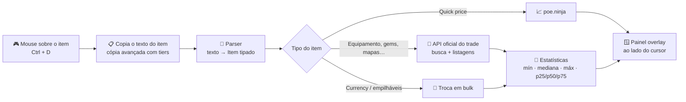
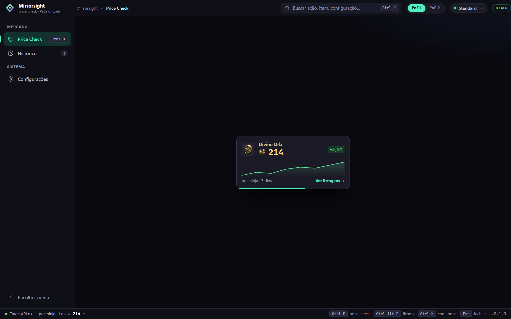

<div align="center">


# Mirrorsight

**Um overlay de price check rápido e bonito para Path of Exile 1 e 2.**
Passe o mouse sobre um item, aperte <kbd>Ctrl</kbd> + <kbd>D</kbd> e saiba quanto ele vale — sem sair do jogo.


[English](README.md) · **Português** · [中文](README.zh-CN.md) · [日本語](README.ja.md) · [한국어](README.ko.md) · [Deutsch](README.de.md) · [Español](README.es.md)


</div>

---

## ✨ O que é o Mirrorsight?

O Mirrorsight é um overlay leve que fica por cima do Path of Exile. Quando você aperta a hotkey sobre
um item, ele lê o item, pesquisa no **trade oficial** com filtros sensatos e mostra — ao lado do
cursor — o **preço estimado**, a **distribuição de preços**, os **filtros por mod editáveis** e as
**listagens ao vivo**. Quando terminar, <kbd>Esc</kbd> fecha o painel e devolve o foco ao jogo.

É escrito em **Rust** (rápido, pouca memória, sem Electron) com interface em **Svelte 5** sobre o **Tauri 2**.

## 🚀 Funcionalidades

| | |
|---|---|
| 🎯 **Price check com uma tecla** | <kbd>Ctrl</kbd>+<kbd>D</kbd> sobre qualquer item abre o painel ao lado do cursor. |
| 🧮 **Estimativa inteligente** | Mínimo, mediana e máximo, mais um indicador de confiança baseado na quantidade de anúncios. |
| 💡 **Preço sugerido** | Percentis *Compra* (p25), *Justo* (p50) e *Venda* (p75), com a nota `~b/o` pronta para copiar. |
| 🎛️ **Filtros por mod editáveis** | Liga/desliga mods, vê o tier (T1…T*n*) e o range do roll, ajusta mín/máx, usa a margem e adiciona mods por busca de texto (pseudo incluídos). |
| 💾 **Presets** | Salve suas combinações de filtros favoritas por jogo e reutilize. |
| 📊 **Gráfico de distribuição** | Histograma dos preços com marcadores p25 / p50 / p75. |
| 💰 **Currency em bulk** | Currency e itens empilháveis são precificados pela troca em massa (preço por unidade, estoque, vendedor). |
| ⚡ **Quick price** | Preço instantâneo do **poe.ninja** com tendência de 7 dias — sem busca no trade. |
| 🕘 **Histórico** | Todo price check fica salvo e pode ser reaberto com os mesmos filtros. |
| ⌨️ **Paleta de comandos** | <kbd>Ctrl</kbd>+<kbd>K</kbd> para ir a qualquer lugar, trocar jogo ou liga, limpar histórico… |
| 🎮 **PoE 1 e PoE 2** | Troque de jogo e de liga pela barra de título. |
| 🛡️ **Respeita o rate limit** | Segue os headers `X-Rate-Limit-*` da API oficial — sem ban, sem spam. |

## 🔍 Como funciona



1. **Captura** – com a janela do jogo em foco, a hotkey dispara o atalho de "copiar item" do próprio
   jogo e lê o texto do clipboard (o conteúdo anterior do clipboard pode ser restaurado automaticamente).
2. **Parse** – o texto vira um item tipado: raridade, base, item level, qualidade, sockets, influências
   e cada modificador casado com a lista de stats da trade API (com tier e range do roll).
3. **Busca** – o Mirrorsight monta a query do trade com os mods que importam (pré-marcados conforme
   suas configurações), respeitando os limites da API.
4. **Análise** – as listagens são convertidas para uma moeda comum (usando a cotação do divine no
   poe.ninja) e resumidas: mín / mediana / máx, percentis, confiança.
5. **Exibição** – o overlay abre ao lado do cursor. Mude qualquer filtro e a busca roda de novo
   sozinha. <kbd>Esc</kbd> fecha e devolve o foco ao jogo.

## 📸 Prints

<table>
  <tr>
    <td width="50%"><br/><sub><b>Price check</b> — estimativa, preço sugerido, filtros e listagens</sub></td>
    <td width="50%"><br/><sub><b>Distribuição</b> — histograma com marcadores de percentil</sub></td>
  </tr>
  <tr>
    <td><br/><sub><b>Currency em bulk</b> — ofertas da troca com estoque</sub></td>
    <td><br/><sub><b>Quick price</b> — valor do poe.ninja e tendência de 7 dias</sub></td>
  </tr>
  <tr>
    <td><br/><sub><b>Paleta de comandos</b> — <kbd>Ctrl</kbd>+<kbd>K</kbd></sub></td>
    <td><br/><sub><b>Configurações</b> — hotkeys remapeáveis</sub></td>
  </tr>
</table>

> Os prints foram tirados no modo demonstração embutido.

## 📦 Como usar

1. **Instale** — gere o instalador (veja [Desenvolver](#-desenvolver)) e rode
   `target/release/bundle/nsis/Mirrorsight_*_x64-setup.exe`. O app fica na bandeja do sistema.
2. **Configure** — em **Configurações → Geral**, escolha o jogo (PoE 1 / PoE 2) e a liga.
3. **Jogue** — no jogo, passe o mouse sobre um item e aperte <kbd>Ctrl</kbd>+<kbd>D</kbd>. <kbd>Esc</kbd> fecha.

Sem o jogo aberto? Cole o texto de um item na janela principal com <kbd>Ctrl</kbd>+<kbd>V</kbd>
(ou <kbd>Ctrl</kbd>+<kbd>Shift</kbd>+<kbd>V</kbd> para quick price).

### ⌨️ Hotkeys padrão

| Hotkey | Ação |
|---|---|
| <kbd>Ctrl</kbd> + <kbd>D</kbd> | Price check do item sob o cursor |
| <kbd>Ctrl</kbd> + <kbd>Alt</kbd> + <kbd>D</kbd> | Price check já fixado na tela |
| <kbd>Shift</kbd> + <kbd>Space</kbd> | Mostrar / ocultar o overlay |
| <kbd>Ctrl</kbd> + <kbd>Shift</kbd> + <kbd>O</kbd> | Abrir configurações |
| <kbd>Ctrl</kbd> + <kbd>K</kbd> | Paleta de comandos (dentro do Mirrorsight) |
| <kbd>Esc</kbd> | Fecha o painel e devolve o foco ao jogo |

Todas as hotkeys globais podem ser remapeadas em **Configurações → Hotkeys**. Elas só ficam
registradas enquanto a janela do jogo está em foco, então nunca roubam teclas de outros apps.

> **Dica:** se o Path of Exile roda como administrador, rode o Mirrorsight como administrador
> também — o Windows bloqueia o envio de teclas de um processo comum para um elevado.

### ⚙️ Configurações

- **Geral** — jogo, liga, idioma do cliente, moeda de exibição, restaurar clipboard, iniciar com o Windows.
- **Price check** — range dos mods, mostrar vendedores offline, filtros marcados por padrão, nível padrão, histórico, presets.
- **Aparência** — escala da interface (90–130 %), densidade, reduzir animações.

## 🛠 Desenvolver

Requisitos: **Rust ≥ 1.80**, **Node ≥ 20**, Windows 10/11 (WebView2).

```sh
cd apps/desktop
npm install
npm run dev          # só a UI, no navegador, com dados de demonstração
npx tauri dev        # o app completo
npx tauri build      # instalador NSIS em <raiz>/target/release/bundle/nsis
```

Testes e lint:

```sh
cargo test --workspace
cargo clippy --workspace --all-targets
cd apps/desktop && npm run check
# contra as APIs reais (consome rate limit — rode com moderação):
cargo test -p mirrorsight-infrastructure --test live -- --ignored --nocapture
```

### 🧱 Arquitetura (clean architecture)

```
crates/domain          entidades, regras puras e ports (traits). Sem I/O.
crates/parser          texto do Ctrl+C / Ctrl+Alt+C → Item (mods casados com stats da trade API)
crates/application     casos de uso (price check, copiar item do jogo, configurações, ligas)
crates/infrastructure  adapters: trade API + rate limiter, poe.ninja, Win32, clipboard, settings
apps/desktop/src-tauri composition root, comandos, hotkeys, overlay, bandeja
apps/desktop/src       UI Svelte 5; fala com o backend só pela porta `Backend`
                       (adapters: Tauri real e demo para o navegador)
```

### 🔄 Manutenção a cada liga

- **Stats da trade API** (o parser depende deles para reconhecer mods):
  `node tools/stats/update-stats.mjs` → atualiza `crates/parser/data/stats-*.tsv`.
- **Ícones de currency**: extraídos da instalação local do jogo para
  `apps/desktop/public/assets/currency/` (PNG + `manifest.json`).

## ⚠️ Aviso

Projeto independente, **não afiliado nem endossado pela Grinding Gear Games**. Arte de itens e
currency © Grinding Gear Games. Usa as APIs públicas de pathofexile.com respeitando os limites
informados nos headers `X-Rate-Limit-*`. Não lê a memória do jogo nem automatiza gameplay — usa apenas
o atalho de copiar item do próprio jogo.

## 📄 Licença

[MIT](LICENSE)
