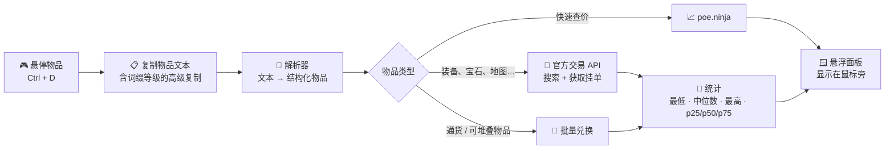
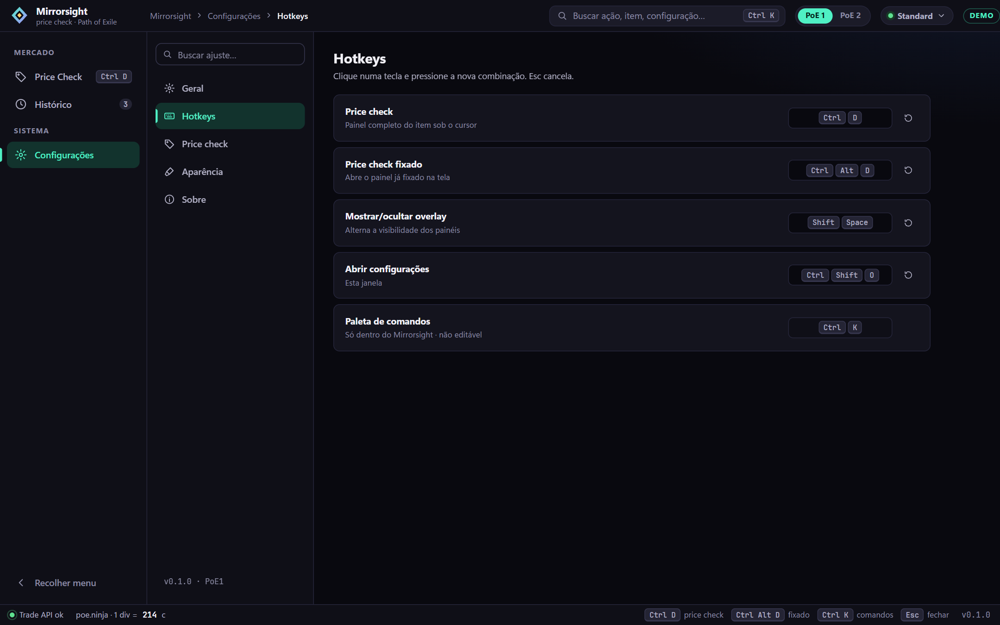

<div align="center">


# Mirrorsight

**为《流放之路》1 & 2 打造的快速、美观的物品查价悬浮窗。**
鼠标悬停在物品上，按下 <kbd>Ctrl</kbd> + <kbd>D</kbd>，无需离开游戏即可知道它值多少钱。


[English](README.md) · [Português](README.pt-BR.md) · **中文** · [日本語](README.ja.md) · [한국어](README.ko.md) · [Deutsch](README.de.md) · [Español](README.es.md)


</div>

---

## ✨ Mirrorsight 是什么？

Mirrorsight 是一个覆盖在《流放之路》(Path of Exile) 之上的轻量级桌面悬浮窗。当你在物品上按下快捷键时，
它会读取物品信息，使用合理的筛选条件搜索**官方交易网站**，并在鼠标旁边直接显示**估算价格**、
**价格分布**、**可编辑的词缀筛选**以及**实时挂单**。查看完毕后，按 <kbd>Esc</kbd> 关闭面板，焦点自动回到游戏。

项目使用 **Rust** 编写（速度快、内存占用低、不使用 Electron），界面基于 **Tauri 2** 与 **Svelte 5**。

## 🚀 功能

| | |
|---|---|
| 🎯 **一键查价** | 在任意物品上按 <kbd>Ctrl</kbd>+<kbd>D</kbd>，面板在鼠标旁打开。 |
| 🧮 **智能估价** | 最低价、中位数和最高价，并根据挂单数量给出可信度指示。 |
| 💡 **建议价格** | *买入* (p25)、*公道* (p50)、*卖出* (p75) 百分位，一键复制 `~b/o` 标价备注。 |
| 🎛️ **可编辑的词缀筛选** | 开关词缀、查看词缀等级 (T1…T*n*) 与数值区间、调整最小/最大值、使用浮动比例滑块、按文本搜索添加词缀（含伪属性）。 |
| 💾 **预设** | 按游戏保存常用的筛选组合并重复使用。 |
| 📊 **价格分布图** | 挂单价格直方图，标注 p25 / p50 / p75。 |
| 💰 **批量通货** | 通货和可堆叠物品通过批量兑换查价（单价、库存、卖家）。 |
| ⚡ **快速查价** | 来自 **poe.ninja** 的即时价格与 7 日走势，无需交易搜索。 |
| 🕘 **历史记录** | 每次查价都会保存，可使用相同筛选重新打开。 |
| ⌨️ **命令面板** | <kbd>Ctrl</kbd>+<kbd>K</kbd> 快速跳转、切换游戏或赛季、清空历史…… |
| 🎮 **支持 PoE 1 与 PoE 2** | 在标题栏切换游戏与赛季。 |
| 🛡️ **遵守速率限制** | 遵循官方 API 的 `X-Rate-Limit-*` 响应头——不封号、不刷请求。 |

## 🔍 工作原理



1. **捕获** —— 当游戏窗口处于焦点时，快捷键会触发游戏自带的“复制物品”快捷键，并从剪贴板读取物品文本
   （可自动恢复之前的剪贴板内容）。
2. **解析** —— 文本被转换为结构化物品：稀有度、基底类型、物品等级、品质、插槽、势力影响，
   以及与交易 API 属性列表匹配的每条词缀（包括词缀等级和数值区间）。
3. **搜索** —— Mirrorsight 根据你关心的词缀（依据设置预先勾选）构建交易查询，并遵守 API 速率限制。
4. **分析** —— 挂单价格统一换算成同一种通货（使用 poe.ninja 的神圣石汇率），并汇总为
   最低 / 中位数 / 最高、百分位与可信度。
5. **展示** —— 悬浮窗在鼠标旁打开。修改任意筛选条件后会自动重新搜索。按 <kbd>Esc</kbd> 关闭并把焦点还给游戏。

## 📸 截图

<table>
  <tr>
    <td width="50%"><br/><sub><b>查价</b> —— 估价、建议价格、词缀筛选与挂单</sub></td>
    <td width="50%"><br/><sub><b>价格分布</b> —— 带百分位标记的直方图</sub></td>
  </tr>
  <tr>
    <td><br/><sub><b>批量通货</b> —— 含库存的兑换报价</sub></td>
    <td><br/><sub><b>快速查价</b> —— poe.ninja 价格与 7 日走势</sub></td>
  </tr>
  <tr>
    <td><br/><sub><b>命令面板</b> —— <kbd>Ctrl</kbd>+<kbd>K</kbd></sub></td>
    <td><br/><sub><b>设置</b> —— 可自定义的快捷键</sub></td>
  </tr>
</table>

> 目前界面语言为巴西葡萄牙语。截图来自内置的演示模式。

## 📦 快速开始

1. **安装** —— 构建安装包（见 [开发](#-开发)），然后运行
   `target/release/bundle/nsis/Mirrorsight_*_x64-setup.exe`。程序常驻系统托盘。
2. **配置** —— 在 **设置 → 常规** 中选择游戏 (PoE 1 / PoE 2) 和赛季。
3. **开玩** —— 在游戏中将鼠标悬停在物品上，按 <kbd>Ctrl</kbd>+<kbd>D</kbd>。按 <kbd>Esc</kbd> 关闭。

没开游戏？用 <kbd>Ctrl</kbd>+<kbd>V</kbd> 把物品文本粘贴到主窗口即可
（<kbd>Ctrl</kbd>+<kbd>Shift</kbd>+<kbd>V</kbd> 为快速查价）。

### ⌨️ 默认快捷键

| 快捷键 | 功能 |
|---|---|
| <kbd>Ctrl</kbd> + <kbd>D</kbd> | 对鼠标下的物品查价 |
| <kbd>Ctrl</kbd> + <kbd>Alt</kbd> + <kbd>D</kbd> | 查价并固定在屏幕上 |
| <kbd>Shift</kbd> + <kbd>Space</kbd> | 显示 / 隐藏悬浮窗 |
| <kbd>Ctrl</kbd> + <kbd>Shift</kbd> + <kbd>O</kbd> | 打开设置 |
| <kbd>Ctrl</kbd> + <kbd>K</kbd> | 命令面板（在 Mirrorsight 内） |
| <kbd>Esc</kbd> | 关闭面板并将焦点还给游戏 |

所有全局快捷键都可在 **设置 → 快捷键** 中重新绑定。它们只在游戏窗口处于焦点时注册，因此不会抢占其他程序的按键。

> **提示：** 如果《流放之路》以管理员身份运行，请同样以管理员身份运行 Mirrorsight——
> Windows 会阻止普通进程向提权进程发送按键。

### ⚙️ 设置

- **常规** —— 游戏、赛季、客户端语言、显示货币、恢复剪贴板、开机自启。
- **查价** —— 词缀数值范围、显示离线卖家、默认勾选的筛选、默认物品等级、历史记录、预设。
- **外观** —— 界面缩放 (90–130 %)、密度、减少动画。

## 🛠 开发

环境要求：**Rust ≥ 1.80**、**Node ≥ 20**、Windows 10/11 (WebView2)。

```sh
cd apps/desktop
npm install
npm run dev          # 仅 UI，在浏览器中使用演示数据运行
npx tauri dev        # 完整桌面应用
npx tauri build      # NSIS 安装包输出到 <根目录>/target/release/bundle/nsis
```

测试与代码检查：

```sh
cargo test --workspace
cargo clippy --workspace --all-targets
cd apps/desktop && npm run check
# 针对真实 API（会消耗速率限制，请适度运行）：
cargo test -p mirrorsight-infrastructure --test live -- --ignored --nocapture
```

### 🧱 架构（整洁架构）

```
crates/domain          实体、纯业务规则与端口 (traits)。无 I/O。
crates/parser          Ctrl+C / Ctrl+Alt+C 文本 → Item（词缀与交易 API 属性匹配）
crates/application     用例（查价、从游戏复制物品、设置、赛季）
crates/infrastructure  适配器：交易 API + 速率限制器、poe.ninja、Win32、剪贴板、设置
apps/desktop/src-tauri 组合根、命令、快捷键、悬浮窗、托盘
apps/desktop/src       Svelte 5 界面；仅通过 `Backend` 端口与后端通信
                       （适配器：真实 Tauri 与浏览器演示）
```

### 🔄 每个赛季的维护

- **交易 API 属性**（解析器依赖它识别词缀）：
  `node tools/stats/update-stats.mjs` → 更新 `crates/parser/data/stats-*.tsv`。
- **通货图标**：从本地游戏安装目录提取到
  `apps/desktop/public/assets/currency/`（PNG + `manifest.json`）。

## ⚠️ 免责声明

Mirrorsight 是独立项目，**与 Grinding Gear Games 无关，也未获其认可**。物品与通货美术 © Grinding Gear Games。
本工具使用 pathofexile.com 的公开 API，并遵守 `X-Rate-Limit-*` 响应头中声明的限制。
它不读取游戏内存，也不自动化任何游戏操作——仅使用游戏自带的复制物品快捷键。

## 📄 许可证

[MIT](LICENSE)
